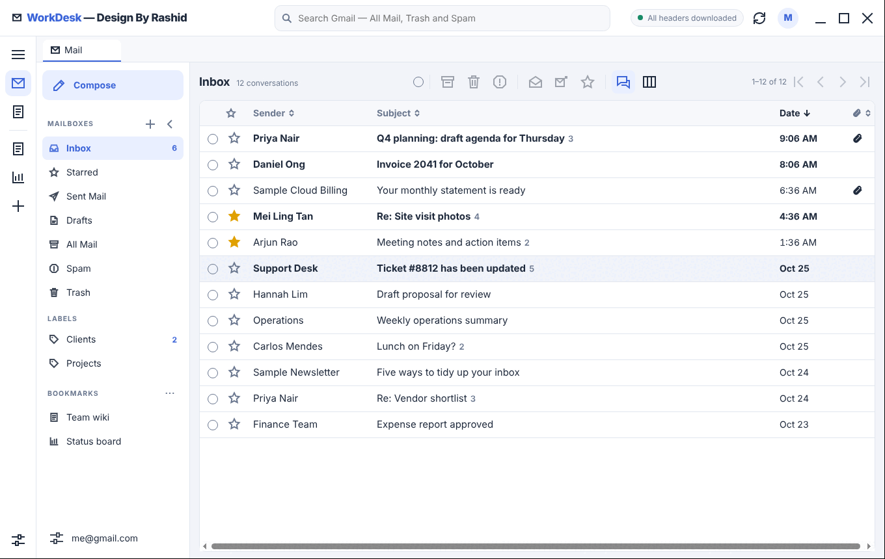
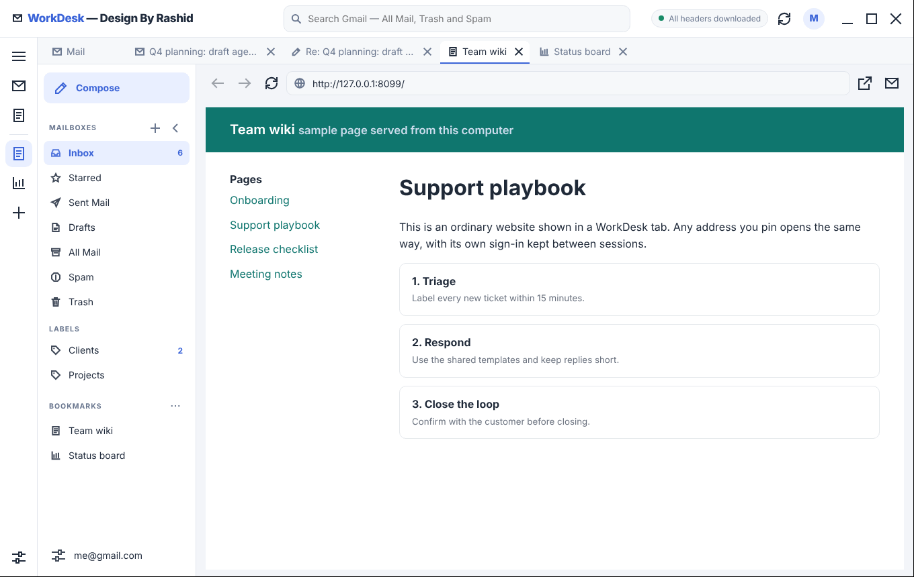
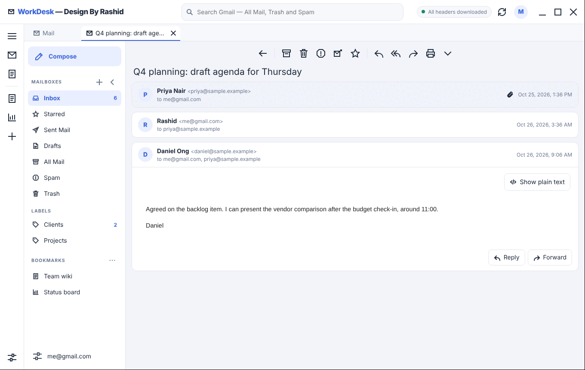
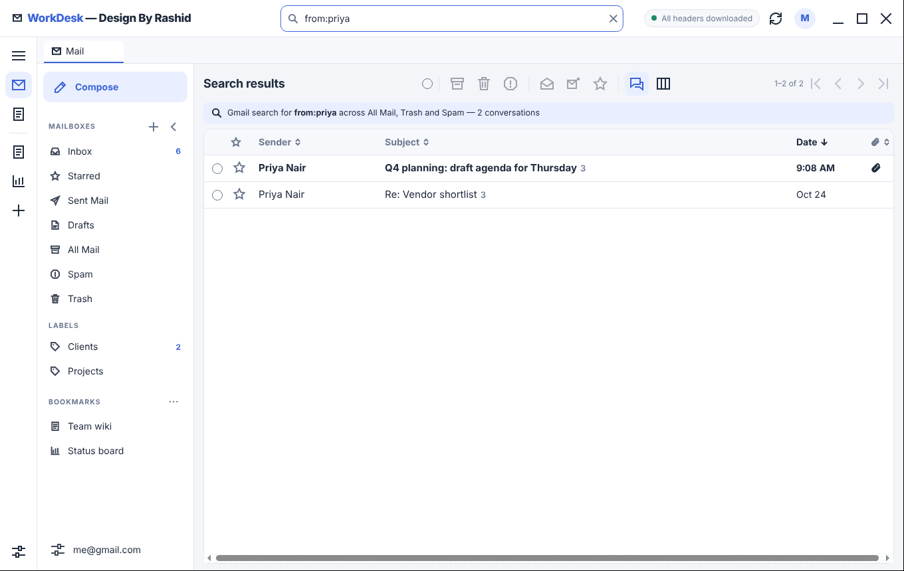
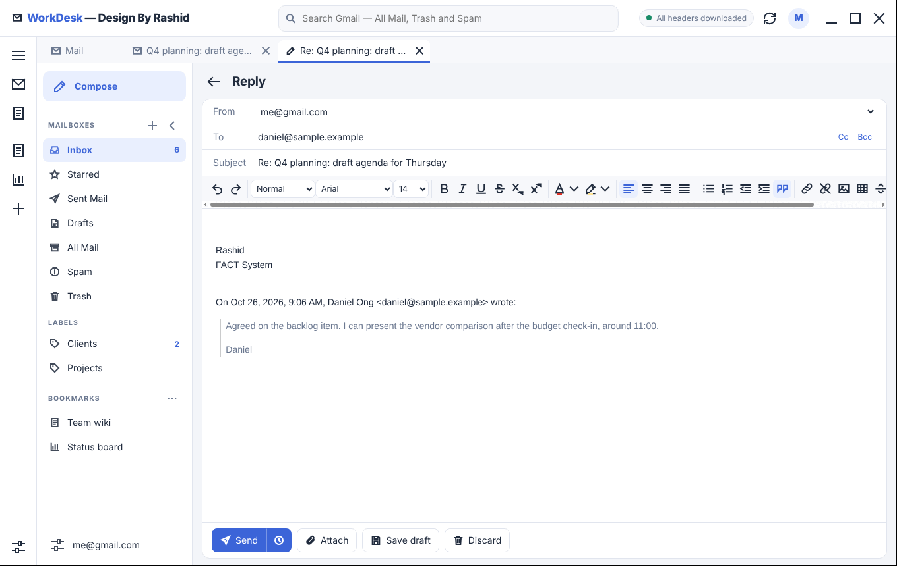
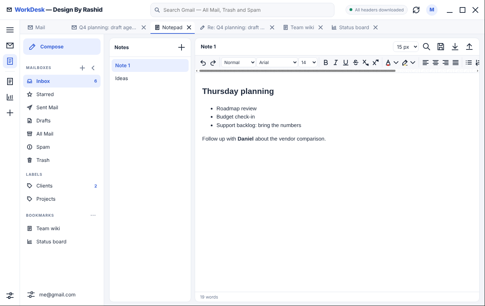
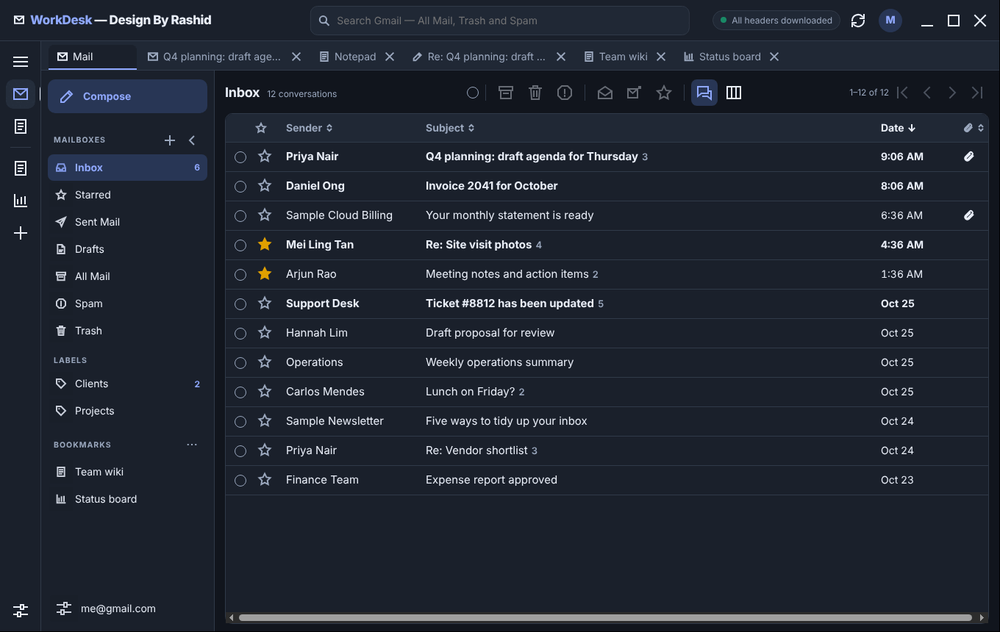
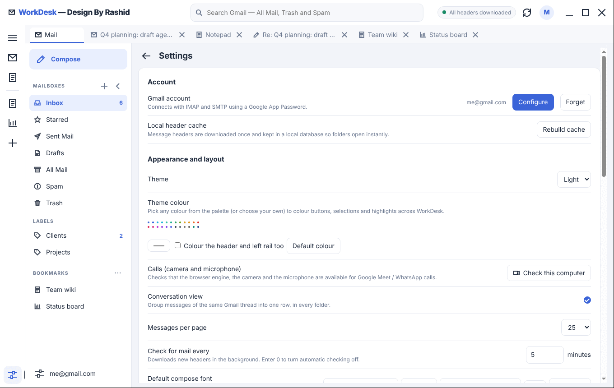

WorkDesk Chrome v2.1 · Design By Rashid

# WorkDesk Chrome

**Your mail and your web apps in one window.**

WorkDesk Chrome is a Gmail desktop client for Linux. It keeps your mailbox, a notepad and the websites you rely on every day (Google Calendar, Google Meet, WhatsApp Web, an intranet, a ticketing system …) together as tabs of a single window. Click a tab to switch. Nothing opens in another window, so there is nothing to alt-tab between.

Mail is read and sent over IMAP/SMTP with a Google App Password, and headers are cached locally, so folders open instantly. Websites run in a real Chromium engine, so Google sign-in, Meet and WhatsApp calls work as they do in Chrome.

*Version 2.1 · Design By Rashid · all screenshots below use fictional sample mail.*



---

## Key features

### One window, many tabs
Mail, every opened conversation, every message you are writing, the Notepad and each website are tabs in one strip along the top. Pin a website and it gets a button in the left rail and an entry in the sidebar. One click opens it as a tab; switching tabs does not reload it.



* Websites are full Chromium pages, with their own saved sign-in. Sign in to Google or WhatsApp once and it is remembered.
* Camera, microphone, notifications and screen sharing are allowed for the sites you open, so Meet and WhatsApp calls work. *Settings → Calls → Check this computer* shows what is available.
* Links that open "in a new window" (and links inside mail messages) open as a new WorkDesk tab instead.
* Back, forward, reload and an address box sit above every website tab. Downloads go to your Downloads folder.
* Right-click in a page for copy, paste and "open link in a new tab".

### Fast Gmail over IMAP/SMTP
Message headers are downloaded once into a local database, then kept up to date in the background (default every 5 minutes, adjustable). Folders, labels and search results open at once, even for large mailboxes. Your Gmail labels appear as folders; Starred, Sent, Drafts, All Mail, Spam and Trash are built in.

### Conversation view
Messages of the same Gmail thread are grouped into one row with a message count, in every folder. Open it to read the whole conversation, each message in its own card. Switch grouping off in Settings if you prefer one row per message.



### Search across everything
The search box looks in All Mail, Trash and Spam, not just the current folder, and understands Gmail-style terms such as `from:priya` or `has:attachment`. Results show which folder each hit lives in.



### A full rich-text composer
Write in a proper editor: fonts, sizes, colours, lists, quotes, links, images, tables and alignment, plus an HTML source view. Replies and forwards quote the original and add your signature automatically.



* **Schedule send**: choose a time and WorkDesk sends it while it is running.
* **Drafts** are saved to Gmail, so they appear on your phone too.
* **Signatures** per account, **Send-as aliases**, Cc/Bcc, attachments.
* **Undo** window after archive, trash and spam (off, 5, 10 or 15 seconds).

### Attachments and privacy
Attachments can be previewed (PDF and images) or saved. Remote images in messages are blocked by default, because they tell the sender you opened the message. You can allow them in Settings. Message HTML is sanitised before it is shown.

### Notepad
A built-in notepad with several notes, rich text, search, adjustable text size, and export as Markdown. Notes are saved automatically on your computer and backed up to `~/Downloads/WorkDesk Notes/`.



### Make it yours
Light and dark themes, a theme colour of your choice (optionally also tinting the header and rail), selectable list columns, page size, default compose font, and a collapsible folder pane.




---

## Getting started

1. **Run it.** Make the AppImage executable and start it:
   ```
   chmod +x WorkDesk-Chrome-v2.1-x86_64.AppImage
   ./WorkDesk-Chrome-v2.1-x86_64.AppImage
   ```
2. **Create a Google App Password** (needed because WorkDesk uses IMAP/SMTP): turn on 2-Step Verification for your Google account, open *Google Account → Security → App passwords*, create one named "WorkDesk" and copy the 16 letters.
3. **Connect.** In WorkDesk choose *Settings → Account → Configure*, enter your Gmail address and the App Password. It is stored in your system keyring, not in a file. Headers start downloading right away.
4. **Pin your websites.** Click **+** in the left rail (or *Settings → Bookmarks*), enter a title and address, tick *Pin to the left rail*. Add Google Calendar, Google Meet, WhatsApp Web or any other address.

## Requirements
* Linux x86-64 (64-bit) with glibc 2.39 or newer, a desktop with a graphical session (X11 or Wayland)
* `libfuse2` for AppImages (or run with `--appimage-extract-and-run`)
* A Gmail or Google Workspace account with 2-Step Verification, and an App Password

## Where things are stored
| What | Where |
|---|---|
| Header cache | `~/.local/share/com.workdesk.app/headers.sqlite` |
| Preferences, bookmarks, signatures | `~/.config/com.workdesk.app/preferences.json` |
| App Password | your system keyring (service `com.workdesk.app`) |
| Notes | `~/.local/share/com.workdesk.app/notes.json`, backup in `~/Downloads/WorkDesk Notes/` |
| Website sign-ins | `~/.config/WorkDesk Chrome/` |
| Log | `~/.local/share/com.workdesk.app/workdesk-chrome.log` |

## Good to know
* Chrome extensions do not run inside WorkDesk.
* A site that needs a pop-up connected back to the page that opened it (some "Sign in with …" buttons) gets the pop-up as a tab, which may not work for that one flow. Signing in on Google's own pages works.
* Scheduled messages and background mail checks run only while WorkDesk is open.
* Menus and messages that pop up over a website tab are shown when you return to a mail or notes tab. Dialogs temporarily hide the website tab.

## Troubleshooting
* **Nothing happens when I start it:** run it from a terminal to see messages, and check the log file above.
* **Mail does not connect:** check IMAP is on (*Gmail → Settings → Forwarding and POP/IMAP*) and that you used an App Password, not your normal password.
* **No camera or microphone in a call:** open *Settings → Calls → Check this computer*, then allow access in your desktop's privacy settings.
* **Reporting a problem:** send the log file and a screenshot.

---
WorkDesk Chrome v2.1 · Design By Rashid
