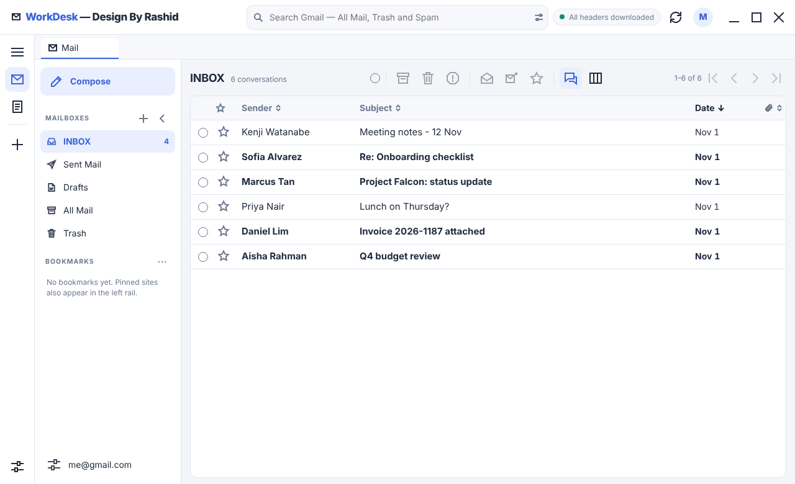
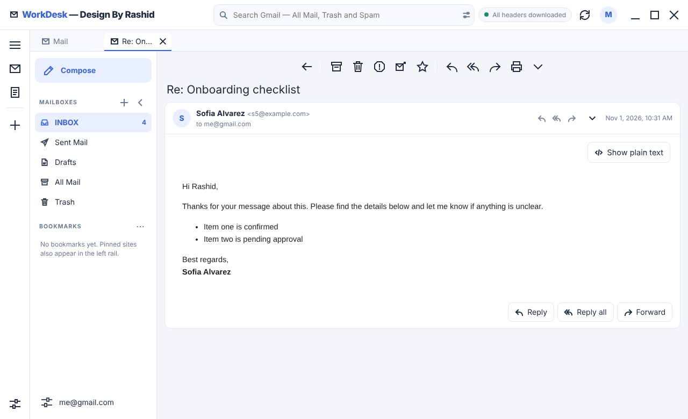
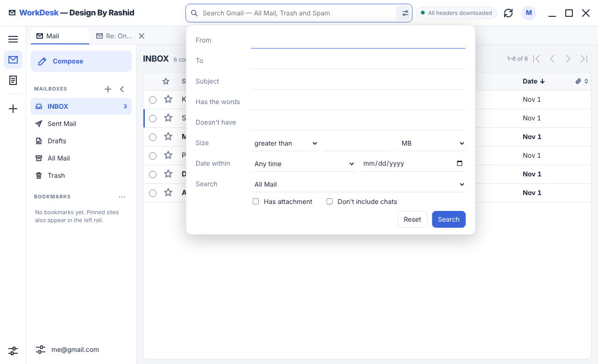
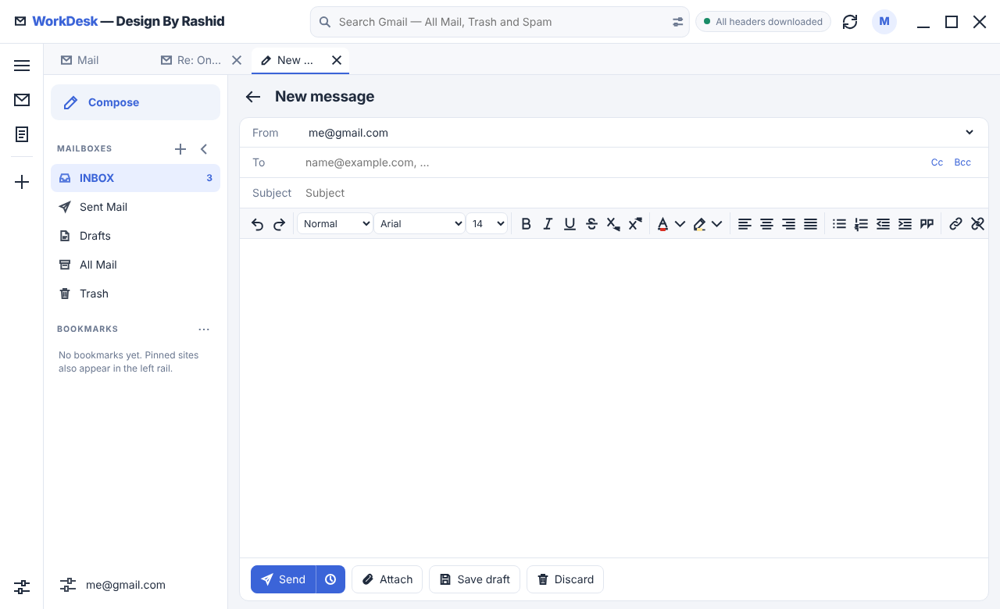
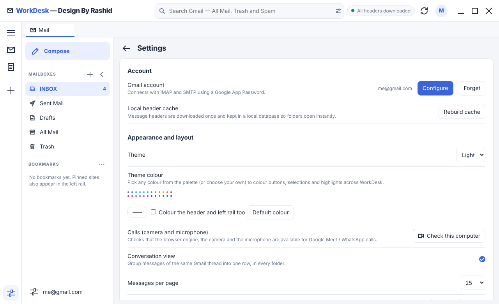
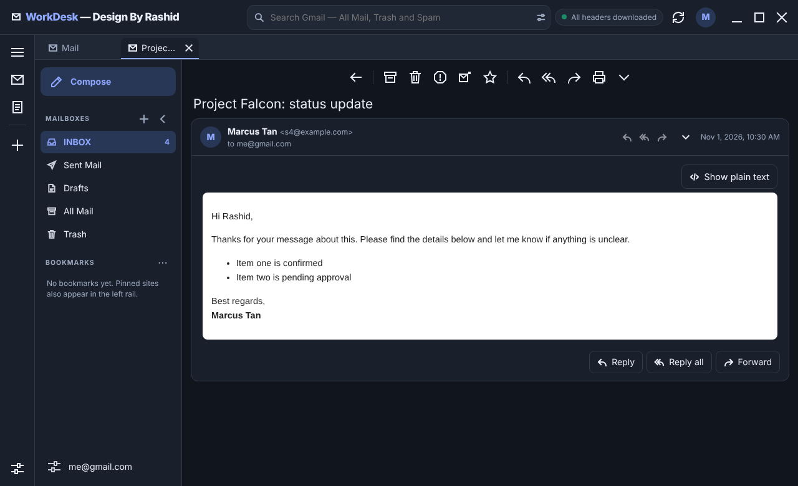

# WorkDesk — Design By Rashid  (v2.10.4)

A Gmail desktop client for Linux that keeps mail, Google Meet, Calendar, WhatsApp and your bookmarked websites in **one window**. Mail talks to Gmail directly over IMAP/SMTP with an **App Password** (no OAuth, no Google API project); websites run in a real Chromium engine, so calls, camera and microphone work.

| Inbox | Reading a message |
|---|---|
|  |  |
| **Expanded search (like Gmail's)** | **Compose** |
|  |  |
| **Settings** | **Dark theme** |
|  |  |

*(Screenshots use a built-in demo mailbox with made-up messages — see `tests/`.)*

## What it does

* **Mail** — conversations (Gmail threads), labels as folders, server-side Gmail search (X-GM-RAW) with an expanded search panel (From, To, Subject, words, size, date, attachment…), flags, archive, spam, trash, **Move to Inbox** from Sent Mail / All Mail (adds the Inbox label, nothing is removed), send-as aliases with a **display name per alias**, drafts you can **edit and continue**, inline images (including pictures sent from the Gmail web client), copy images, attachments shown at the end or at the top of a message, a contacts manager, PDF preview with marking/signature/print, Notepad.
* **Scheduled send** that works even after WorkDesk is closed (see below).
* **Speed** — message headers are cached in a local SQLite database. In addition, after start-up the newest 500 messages of **Inbox, Sent Mail and All Mail** are downloaded **into memory only** (never to disk) so they open instantly; a message stored under several Gmail labels is held once. Pointing at a message or opening a conversation downloads it ahead of the click. Ready IMAP connections are kept for a few minutes so a message that is not in memory does not pay for a new Gmail login.
* **Website tabs** — Meet, Calendar, WhatsApp and any bookmark, in tabs next to Mail; pop-ups become tabs.

## How it works

```
Electron shell (electron/main.js)  ── window, tabs, website views, Document-PiP guard, favicon/image fetch
        │ starts, stdin kept open
        ▼
Rust backend (backend/)            ── one executable
   • local web server on 127.0.0.1 (random port + secret token + cookie)
       serves the embedded frontend, answers POST /rpc/<command>, streams events (/events)
   • IMAP/SMTP, header cache (SQLite), message caches, scheduler, vault, preferences, notes
        ▲
Frontend (dist/)                   ── HTML/JS/CSS, embedded into the backend binary at compile time
```

`WORKDESK_SHELL=electron` makes the backend run under the shell (it prints `WD_READY {port, token, url}` and exits when the shell closes its stdin).

### Scheduled send
A scheduled message is a file in `~/.local/share/com.workdesk.app/scheduled/`. WorkDesk starts a **detached helper** (a private copy of the program, `workdesk-sender --send-scheduled`) that sends messages when they are due, so they go out after you close WorkDesk. Limits: the computer must be on (not suspended or shut down); if it is off at the due time, the message is sent the next time WorkDesk (or the helper) starts. A failed send is retried 3 times, one minute apart, then stays in the list with its error. These messages are sent by WorkDesk, not stored in Gmail's own "Scheduled" label.

### Where data lives
| What | Where |
|---|---|
| Header cache, scheduled mail, notes | `~/.local/share/com.workdesk.app/` |
| Preferences | `~/.config/com.workdesk.app/preferences.json` |
| **App Password** | `~/.config/com.workdesk.app/vault.json` + `vault.key` — AES-256-GCM; key = SHA-256("workdesk-vault-v1" ‖ vault.key ‖ `/etc/machine-id`). Older keyring entries are copied into the vault once. Copying the folder to another computer will not unlock it (different machine-id): re-enter the App Password. |
| Notepad backup | `~/Downloads/WorkDesk Notes/` |
| Downloaded message bodies | **memory only** (up to 600 MB), discarded when WorkDesk closes |

## Run

```bash
cat WorkDesk-Chrome-v2.10.4-x86_64.AppImage.part* > WorkDesk-Chrome-v2.10.4-x86_64.AppImage   # if delivered in parts
chmod +x WorkDesk-Chrome-v2.10.4-x86_64.AppImage
./WorkDesk-Chrome-v2.10.4-x86_64.AppImage
```
Linux x86-64, glibc 2.39+ (e.g. Debian 13 / Q4OS Trixie), OpenSSL 3. Starting a second copy raises the running window. In Settings → Gmail account, enter your address and a Google **App Password** (2-Step Verification must be on; IMAP is always on for Gmail).

## Source layout

| Folder / file | State |
|---|---|
| `backend/` | Rust backend — **complete and current**. |
| `electron/` | Electron shell — **current** (`main.js`, `preload.js`, `package.json`). |
| `dist/` | **Current frontend (v2.10)** — the finished, minified build that is embedded into the backend. It was recovered from the v2.10.1 AppImage (the readable sources were lost) with the inline-image fix applied. **Edit it here; do not rebuild it from the files below.** |
| `main.js`, `sanitize.js`, `editor.js`, `viewer.js`, `annot.js`, `notes.js`, `icons.js`, `util.js`, `bridge.js`, `styles.css`, `index.html`, `vite.config.js` | Readable frontend sources of **v2.3 — outdated** (no contacts manager, expanded search, alias table, Move to Inbox, draft editing, …). Kept as a reference for names and structure. `npm run build` is disabled so `dist/` cannot be overwritten by them. |
| `packaging/` | AppImage assembly script, desktop file, icon. |
| `tests/` | `fake_imap.py` (a small fake Gmail IMAP server), `drive.py` (end-to-end test of the backend), `shots.py` (makes the screenshots). |
| `CHANGELOG-*.md` | Release notes that were kept (v1.0.0, v1.0.4, v2.3, v2.10.3, v2.10.4). |

## Build from source

```bash
sudo apt install -y build-essential pkg-config libssl-dev curl file squashfs-tools
# Rust stable (1.80+)
cargo build --release --manifest-path backend/Cargo.toml      # embeds dist/
cargo test  --release --manifest-path backend/Cargo.toml      # unit tests
export ELECTRON_DIR=/path/to/unpacked/electron-v41-linux-x64  # folder containing the `electron` binary
./packaging/make-appimage.sh                                   # needs appimagetool (downloaded if absent)
```

### Test the backend without Gmail
Debug builds accept `MAILDESK_IMAP_ADDR=host:port` and talk plain IMAP to it:
```bash
cargo build --manifest-path backend/Cargo.toml
python3 tests/drive.py backend/target/debug/workdesk-chrome     # background download, instant open, Move to Inbox,
                                                                # drafts, scheduler, inline images, connection reuse
WD_DEMO=1 python3 tests/shots.py backend/target/debug/workdesk-chrome /tmp/shots   # regenerate screenshots (needs `pip install playwright`)
```
(SMTP always goes to `smtp.gmail.com`, so an actual send is not covered by the fake server.)

## Backend commands (POST `/rpc/<name>`, JSON arguments, camelCase or snake_case)
Account: `save_credentials`, `delete_credentials`, `test_connection`. Folders/sync: `list_folders`, `create_folder`, `delete_folder`, `start_sync`, `sync_folder_now`, `sync_running`, `clear_cache`, `folder_validity`. Lists: `list_page`, `search_mail`, `thread_messages` (`refresh` false = cache only). Messages: `get_message` (`markSeen`), `prefetch_message`, `warm_inbox`, `get_attachment`, `set_flag`, `move_messages`, `add_to_inbox`, `delete_forever`. Sending: `send_email`, `save_draft`, `discard_draft`, `schedule_send`, `list_scheduled`, `cancel_scheduled`, `send_scheduled_now`. Misc: `list_contacts`, `load_preferences`, `save_preferences`, `save_attachment`, notes (`notes_*`), `open_external`, `list_browsers`, website tabs and window (`site_*`, `win_action`, `app_info`, handled by the shell).

## Troubleshooting
* *"No saved App Password"* — enter it again in Settings (happens after copying data between computers).
* A scheduled message shows an error — it is retried; check the network and the App Password, or use *Send now*.
* Messages still open slowly — only the newest 500 of Inbox/Sent/All Mail are pre-downloaded; older ones are fetched once, then stay in memory for the session.
* Logs: run the AppImage from a terminal; backend messages go to stderr.
